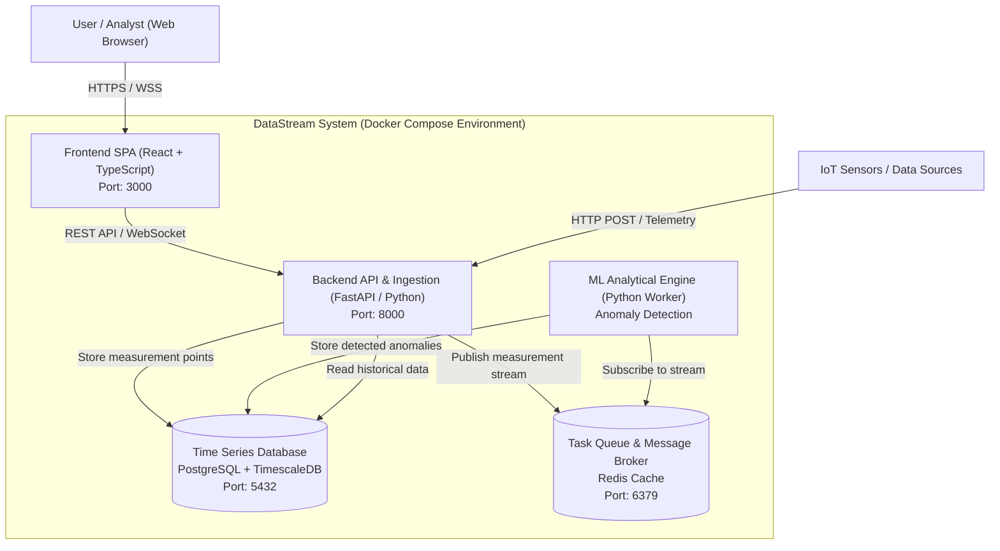

# Document Stage 2: System Architecture and Technical Design (Architecture & Technical Design)

**Engineering / Master's Project – Faculty of MIS PW**

---

## 1. System Architecture (C4 Model – Container Diagram)

The diagram below illustrates the logical division of the system into containers, communication protocols, and data stores:



---

## 2. Justification of Technology Stack Choice

| Module / Component    | Selected Technology                      | Considered Alternatives   | Justification and Trade-offs                                                                                                                            |
| :-------------------- | :--------------------------------------- | :------------------------ | :------------------------------------------------------------------------------------------------------------------------------------------------------ |
| **Backend API** | **FastAPI (Python 3.11)**          | Django, Flask, Express.js | High asynchronous performance (ASGI), automatic OpenAPI/Swagger schema generation, native integration with ML libraries (NumPy, PyTorch, scikit-learn). |
| **Database**    | **PostgreSQL + TimescaleDB**       | InfluxDB, MongoDB         | Combines efficient time partitioning (hypertables) with full relational and transactional SQL capabilities for users and metadata.                      |
| **Task Broker** | **Redis (Pub/Sub + Streams)**      | Apache Kafka, RabbitMQ    | Low memory overhead ($< 50$ MB RAM vs $> 1$ GB for Kafka), simplicity of configuration in Docker on lab machines.                                   |
| **Frontend**    | **React + TailwindCSS + Chart.js** | Vue, Angular              | Rich ecosystem of libraries for interactive time series visualization, high modularity of components.                                                   |
| **Deployment**  | **Docker & Docker Compose**        | Bare-metal, Minikube      | Ensures reproducibility of the environment in the MiNI PW lab regardless of the operating system (Linux/macOS/Windows).                                 |

---

## 3. API Contracts (OpenAPI / Swagger Specification)

### Measurement Ingestion Endpoint: `POST /api/v1/metrics`

* **Headers:** `Content-Type: application/json`, `Authorization: Bearer <token>`
* **Request Body:**

```json
{
  "sensor_id": "sensor-alpha-001",
  "timestamp": "2024-10-24T14:30:00Z",
  "metric_name": "temperature_celsius",
  "value": 24.85,
  "tags": {
    "location": "lab-412",
    "device_model": "ESP32"
  }
}
```

* **Response (Response 201 Created):**

```json
{
  "status": "success",
  "metric_id": 982341,
  "is_anomaly": false,
  "anomaly_score": 0.12
}
```

### Historical Query Endpoint: `GET /api/v1/sensors/{sensor_id}/metrics`

* **URL Parameters:** `from=2024-10-24T00:00:00Z&to=2024-10-24T23:59:59Z&limit=1000`
* **Response (Response 200 OK):** Returns an array of measurement points along with anomaly markers and model confidence levels.

---

## 4. Database Schema (Relational ERD)

```sql
-- Sensors and metadata table
CREATE TABLE sensors (
    sensor_id VARCHAR(64) PRIMARY KEY,
    name VARCHAR(128) NOT NULL,
    device_model VARCHAR(64),
    created_at TIMESTAMPTZ DEFAULT NOW()
);

-- Time series hypertable (TimescaleDB)
CREATE TABLE sensor_metrics (
    time TIMESTAMPTZ NOT NULL,
    sensor_id VARCHAR(64) REFERENCES sensors(sensor_id),
    metric_name VARCHAR(64) NOT NULL,
    value DOUBLE PRECISION NOT NULL,
    is_anomaly BOOLEAN DEFAULT FALSE,
    anomaly_score DOUBLE PRECISION DEFAULT 0.0
);

SELECT create_hypertable('sensor_metrics', 'time');
```

---

## 5. Deployment Topology and Security

* All services communicate within an isolated Docker virtual network (`datastream-net`).
* Database data is persisted in the volume `datastream_pgdata`.
* External access is limited to port 8000 (API) and port 3000 (UI).
* Password and key configurations are passed exclusively through environment variables from the `.env` file (template in `.env.example`).

---

## 6. Team Independence Verification (Modular Independence Check)

* [X] **Task Separation:** Defined OpenAPI contracts allow parallel work by the Frontend developer (Carol) and Backend developer (Bob) using generated mock data.
* [X] **Isolation of Analytical Engine:** The anomaly detection module (David) communicates solely through the Redis broker, not blocking the development of the database and API.

---

**Supervisor Signature (Architecture Acceptance):** ............................................ **Date:** 05.11.2026
